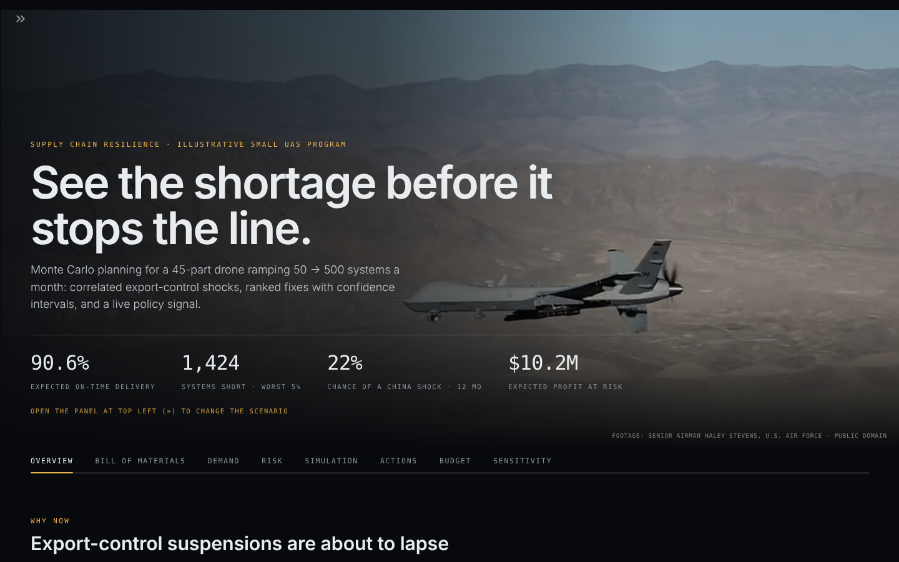
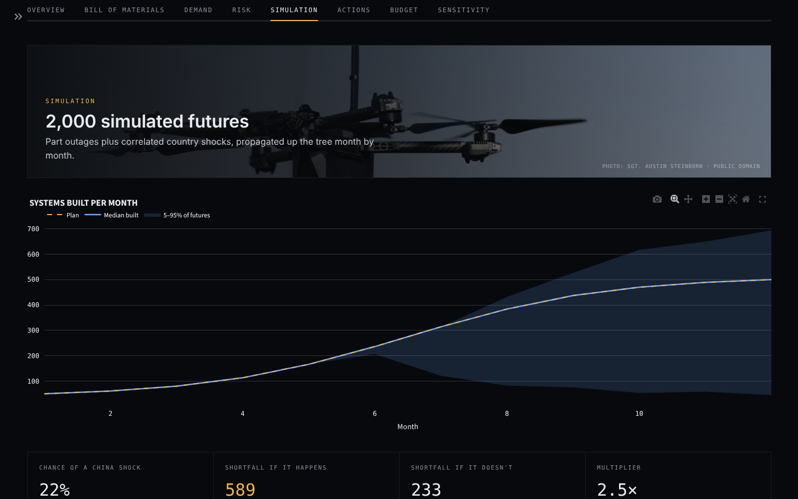
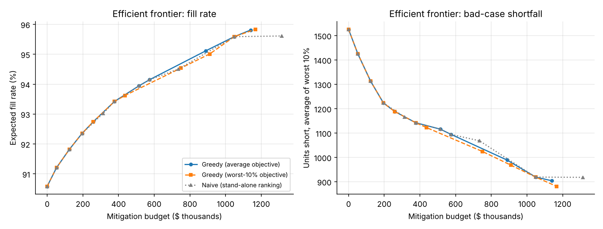
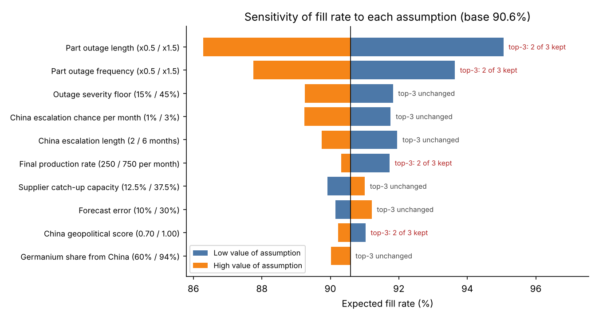

# UAS Supply Chain Resilience Planner

**Recommendation (50 → 500 systems/month over 12 months):** At current risk levels the ramp delivers **90.6%** of 3,300 systems on time. Fund three supplier qualifications now: **graphite anode material, gallium nitride (GaN) power transistors, and rare-earth (NdFeB) magnets**. They cost about **$196k** and lift on-time delivery to **92.4%**, each returning 8–13× its cost in profit at risk. Two Chinese export-control suspensions covering these materials lapse on **10 and 27 November 2026**. Treating those deadlines as live risk lowers expected on-time delivery to **88.0%**. → **[One-page memo](docs/MEMO.md)** · **[Live dashboard](https://supply-chain-resilience-dhrn2yt5vphhkappfxannjd.streamlit.app/)**

> The bill of materials (BOM) is **illustrative**: a generic Group 2 small unmanned aircraft system assembled from public information. It does not represent any real product or company data. Material shares and policy dates are cited ([SOURCES.md](docs/SOURCES.md)). Outage rates and costs are explicit, documented assumptions.





## What it does

| Module | Question it answers | Method |
|---|---|---|
| `src/bom.py` | How many of each part go into one system? | Multi-level bill-of-materials explosion (extended quantity) with validation: one root, no cycles, no orphans |
| `src/demand.py` | How many do we need each month, and when must we order? | S-curve production ramp → time-phased requirements → lead-time offset (material requirements planning). Safety stock for demand **and** lead-time uncertainty. Lot sizing: economic order quantity vs. supplier minimum order quantity |
| `src/risk.py` | Which parts are most likely to cause trouble, and why? | 4-factor score: material concentration (Herfindahl-Hirschman Index), geopolitical exposure, 95th-percentile lead time, single-source flag. Compliance flags for drone critical components (FY2020 NDAA §848) |
| `src/simulate.py` | How many systems will we actually ship? What fixes help? | Monte Carlo (2,000 futures): part-level outages **plus correlated country shocks**, propagated up the tree, with shipment slips, supplier catch-up and lot sizing. Each action gets a paired 95% confidence interval (common random numbers) and a bad-case score |
| `src/optimize.py` | What should we fund with a given budget? | Greedy selection that **re-simulates after every pick** (benefits overlap, so they don't add up). Two objectives: average shortfall, or average of the worst 10% of futures. Efficient frontier |
| `src/sensitivity.py` | Would the advice change if the assumptions are wrong? | 10 assumptions moved low/high with the same random draws. Tornado chart and recommendation-stability check |
| `src/signals.py` | Is the risk rising right now? | Cited policy calendar (suspended controls nearing expiry), GDELT news volume, and United States export-control rule-making (Federal Register), refreshed daily by a scheduled GitHub job |
| `app.py` | Interactive what-if | Streamlit dashboard, 8 tabs |

## Results



- **Diminishing returns:** the first ~$375k raises on-time delivery from 90.6% to 93.4%, and the next ~$770k adds about 2.4 points more.
- **Re-simulation beats a one-shot ranking:** funding actions in stand-alone order eventually spends $266k on an assembly bundle that adds nothing.
- **Average case vs. bad case:** a second supplier is the best value on average, but it can't offset a cutoff of the *material*. When a China shock hits, buffer stock on the battery pack and speed controller matters most, and expected shortfall is 2.5× higher.



- **The #1 recommendation held in all 20 cases, and the top-3 set in 16.** The biggest uncertainty is how long and how often part outages last, so validate those against real supplier history first.

## Key formulas

- **Extended quantity:** `ext(part) = Π qty_per_parent` along the path to the root
- **Safety stock:** `SS = z · sqrt(L·σd² + d²·σL²)` (law of total variance on demand during lead time)
- **Economic order quantity:** `Q* = sqrt(2·D·S / H)`, lot = `max(Q*, MOQ)`
- **Concentration (HHI):** `Σ sᵢ²` over producing countries (1 = single country)
- **Risk score:** `Σ wₖ · fₖ`, each factor scaled to [0, 1]
- **Slip probability:** `P(LT > μ + 1 month) = 1 − Φ(4.33 / σ_LT)`
- **Correlated shock:** material loss for part *i* = China's share of its material × shock severity (backup suppliers don't help)
- **Bad-case objective:** conditional value at risk, the average shortfall in the worst 10% of futures
- **Paired confidence interval:** `mean(Δ) ± 1.96 · sd(Δ)/√N`, Δ = baseline − scenario on the same random draws

## Run it

```bash
pip install -r requirements.txt
python run_analysis.py      # full analysis + optimizer; CSVs to outputs/, frontier chart to docs/
python run_sensitivity.py   # tornado chart + stability table (~40 s)
python run_signal.py        # today's live risk signal (needs internet for the news part)
streamlit run app.py        # dashboard
pytest -q                   # tests
```

### Daily risk-signal refresh

`.github/workflows/refresh-signal.yml` runs `scripts/refresh_signal.py` every day at 14:17 UTC on GitHub's servers. Each run:

1. Measures news volume on Chinese export controls for each exposed material (GDELT) against its usual level
2. Counts China- and chip-related export-control rules from the US Bureau of Industry and Security (Federal Register) against their usual pace. US tightening is a leading indicator: China's December 2024 gallium ban was retaliation for US chip controls
3. Writes the combined multiplier to `data/external_signal.json`, appends a row to `data/signal_history.csv`, and commits. Streamlit Cloud redeploys on the push, so the dashboard's live-signal toggle and history chart update automatically

A failed fetch is logged but never overwrites the last good signal. Signals older than 14 days are ignored. You can also trigger a run by hand from the repository's **Actions** tab (**Refresh risk signal → Run workflow**).

Any other model can publish its own multiplier the same way:

```bash
python run_signal.py --publish CHN 1.8 --source my-model
```

## Media credits

The dashboard's background video and photos are U.S. government works in the public domain, downloaded from Wikimedia Commons by `scripts/fetch_media.py` (which refuses any file not marked public domain) and listed in `static/credits.json`:

| Asset | Credit | Source |
|---|---|---|
| Hero video: MQ-9 in flight over Nevada | Senior Airman Haley Stevens, U.S. Air Force | [Wikimedia Commons](https://commons.wikimedia.org/wiki/File:MQ-9_Reaper_aerial_video_DOD_107212162-5e1342c0d88af.webm) |
| Airmen assembling an MQ-9, Hurlburt Field | Staff Sgt. John Bainter, U.S. Air Force | [Wikimedia Commons](https://commons.wikimedia.org/wiki/File:Rise_of_the_Reaper_140423-F-RS318-157.jpg) |
| B-25 final assembly line, Inglewood, 1942 | Alfred T. Palmer, Office of War Information (Library of Congress) | [Wikimedia Commons](https://commons.wikimedia.org/wiki/File:B-25_final_assembly_line_Inglewood_1942.jpg) |
| Small quadcopter in flight, Romania, 2025 | Sgt. Austin Steinborn, U.S. Army | [Wikimedia Commons](https://commons.wikimedia.org/wiki/File:Skydio_drone_flies_during_Dynamic_Front_25_in_Sm%C3%A2rdan,_Romania.jpg) |

The appearance of U.S. Department of Defense visual information does not imply or constitute DoD endorsement. Fonts: Inter and JetBrains Mono (SIL Open Font License).

## Assumptions and limitations

- Bill of materials, costs, lead times and minimum order quantities are illustrative
- Outage rates are mapped from risk factors by assumption, not fitted to historical data (this is the top sensitivity)
- Country risk scores are judgment calls with written rationale in `data/country_risk.csv`
- Monthly time steps; no supplier capacity caps
- The live-signal multiplier applies for the whole horizon even though deadlines are one-time events
- The news and rule-making coefficients are simple documented choices, not fitted to past shocks
- Greedy selection is a heuristic, not a proven optimum
- Compliance output is a set of flags for review, not legal conclusions

## Roadmap

- Fit outage frequency and length to real supplier delivery history
- Time-varying shock probability around policy deadlines
- Supplier capacity limits and allocation during shortages
- Exact optimization (mixed-integer program on a linearized benefit model) to benchmark the greedy picks
